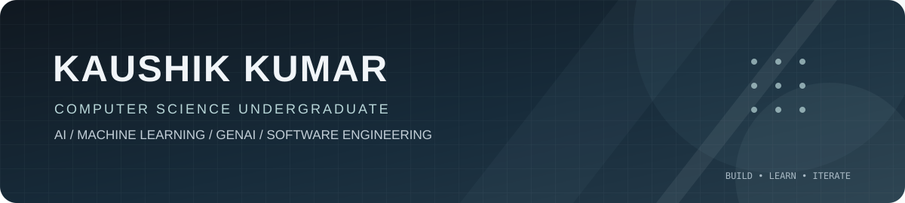
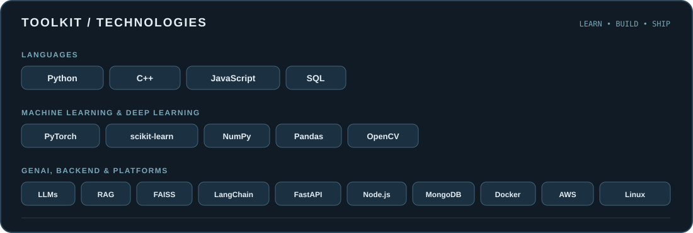

<!--
  KkaushikK18 — GitHub profile README
  All README images are stored in this repository under /assets.
-->

### Building practical AI systems, from models to usable products.

[**Portfolio**](https://kaushik18portfolio.vercel.app/) &nbsp;·&nbsp;
[**Email**](mailto:kaushikk06703@gmail.com) &nbsp;·&nbsp;
[**GitHub**](https://github.com/KkaushikK18)

---

## About

I'm interested in building reliable, end-to-end software with a focus on **Machine Learning, Deep Learning, and Generative AI**.

- Exploring LLM applications, retrieval-augmented generation, and Text-to-SQL systems.
- Building with PyTorch and computer vision, including image-forgery detection.
- Interested in the engineering behind AI products: data pipelines, APIs, evaluation, and deployment.
- Strengthening problem-solving, backend development, and system design fundamentals.

## Tech stack

## Selected projects

<table>
  <tr>
    <td width="50%" valign="top">
      <h3>Text2SQL with LLMs + RAG</h3>
      
Natural-language-to-SQL workflow using schema retrieval, embeddings, FAISS, LLM-based SQL generation, validation, and database execution.

      <a href="https://github.com/KkaushikK18/Text2SQL-using-LLMs-RAG-and-Vector-DBs">Explore repository →</a>
    </td>
    <td width="50%" valign="top">
      <h3>Sentin AI</h3>
      
AI-powered behavior anomaly detection project focused on identifying unusual patterns from data.

      <a href="https://github.com/KkaushikK18/Sentin-AI-AI-Powered-Behavior-Anamoly-Detection">Explore repository →</a>
    </td>
  </tr>
  <tr>
    <td width="50%" valign="top">
      <h3>Image Forgery Detection</h3>
      
Deep-learning image manipulation detection using computer-vision techniques and model interpretability.

      <a href="https://github.com/KkaushikK18/Image-Forgery-Detection">Explore repository →</a>
    </td>
    <td width="50%" valign="top">
      <h3>Full-stack applications</h3>
      
Web applications combining backend services, databases, and user-facing interfaces.

      <a href="https://github.com/KkaushikK18/Job-Portal">Job Portal</a> ·
      <a href="https://github.com/KkaushikK18/BloodBond">BloodBond</a> ·
      <a href="https://github.com/KkaushikK18/Credit-Score">Credit Score</a>
    </td>
  </tr>
</table>

  
<strong>More repositories</strong>

  - **AI / ML:** [Movie Recommendation](https://github.com/KkaushikK18/Movie-Recommendation), [AI Risk Prediction Engine](https://github.com/KkaushikK18/AI-Driven-Risk-Prediction-Engine-for-Chronic-Care-Patients)
  - **Computer Science:** [DSA](https://github.com/KkaushikK18/DSA), [A* Path Finder](https://github.com/KkaushikK18/AStarPathFinder)
  - **NLP:** [Text Preprocessing Basics](https://github.com/KkaushikK18/textPreprocessingBasicsNLP), [TensorTonic Solutions](https://github.com/KkaushikK18/TensorTonic-Solutions)

## GitHub activity

Explore my live activity directly on GitHub:

[Contribution activity](https://github.com/KkaushikK18?tab=overview) &nbsp;·&nbsp;
[Repositories](https://github.com/KkaushikK18?tab=repositories) &nbsp;·&nbsp;
[Starred projects](https://github.com/KkaushikK18?tab=stars)

## Contribution snake

Automatically refreshed every day by GitHub Actions.

---

**Interested in AI engineering, useful software, and thoughtful collaboration.**

[Portfolio](https://kaushik18portfolio.vercel.app/) &nbsp;·&nbsp;
[Email](mailto:kaushikk06703@gmail.com) &nbsp;·&nbsp;
[GitHub](https://github.com/KkaushikK18)

Thanks for visiting. Feel free to explore my repositories.

